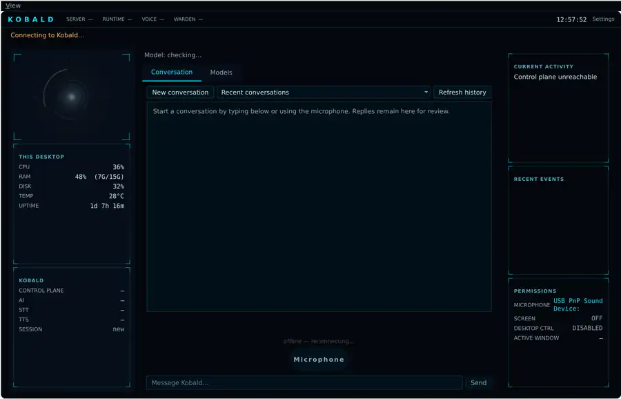
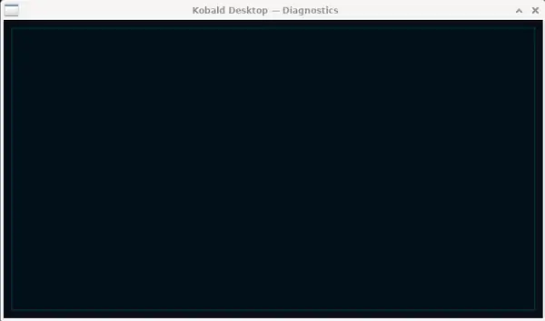

<p align="center">
  
</p>

# Kobald

**Kobald is an open-source private AI system designed to sit above interchangeable AI models and give the user control over the knowledge, tools, data and hardware around them.**

The project is built around a larger question: **how much should we trust an AI answer when we cannot properly verify how it reached it?**

Modern AI can answer complicated questions in seconds, but that convenience also makes it easy to accept an answer without checking the information behind it. Kobald is an experiment in keeping the usefulness of AI while making the process around its answers more inspectable, reproducible and controlled by the user.

**Kobald is still an early research project. Many of the systems described in this repository are development goals rather than finished features.**

> **Governing principle: evidence before authority.**

> **This repository is the public showcase, not the complete Kobald source repository.** The main implementation, private automated test suite, internal developer documentation and infrastructure configuration are maintained separately.

## Contents

| Section | What it covers |
|---|---|
| [What Kobald actually is](#what-kobald-actually-is) | The basic idea and how Kobald sits around interchangeable AI models |
| [Why Kobald exists](#why-kobald-exists) | The trust and reproducibility problem the project is trying to address |
| [What can Kobald do right now?](#what-can-kobald-do-right-now) | Features that currently exist |
| [What Kobald cannot do yet](#what-kobald-cannot-do-yet) | Current limitations and unfinished systems |
| [Kobald vs Ollama or llama.cpp](#kobald-vs-ollama-or-llamacpp) | Why Kobald is different from simply running a local model |
| [What Kobald is being built toward](#what-kobald-is-being-built-toward) | The intended research workflow and longer-term system |
| [Privacy and local operation](#privacy-and-local-operation) | Why local AI and user-controlled data matter |
| [Open source and customisation](#open-source-and-customisation) | How different Kobald installations could be adapted |
| [Evidence before authority](#evidence-before-authority) | The main design principle behind the project |
| [Desktop Interface](#desktop-interface) | Current Command Centre screenshots |
| [Technical documentation](#technical-documentation) | Architecture, testing, history and evaluation documents |
| [Why more compute matters](#why-more-compute-matters) | What additional local hardware would enable |
| [Project direction](#project-direction) | Planned development areas |
| [Project status](#project-status) | Current POC and research status |
| [Summary](#summary) | Trust, privacy and control in short form |
| [Support and technical review](#support-and-technical-review) | Hardware, mentorship and review information |

## What Kobald actually is

Kobald is not a new foundation model and it is not trying to replace models such as Qwen, Llama or other local and cloud models.

The model is intended to be interchangeable. Kobald is the system around it.

That surrounding system is being developed to include things such as:

- a private knowledge vault
- research and evidence handling
- tools and external programs
- scientific simulations
- persistent memory
- agents and workers
- cybersecurity and privacy tooling
- sensors and other connected systems
- automation
- optional robotics and physical hardware

At its base, Kobald is intended to operate as a research assistant. Because the project is open source, different installations could be adapted for completely different jobs.

A scientific setup could connect simulation software and datasets. A business could connect private documents. A home system could connect environmental sensors. A cybersecurity setup could provide authorised security tools and network information. A robotics project could expose sensors and physical movement to the same system.

The AI model is only one part of Kobald.

## Why Kobald exists

Before generative AI became common, answering a difficult question often meant researching the topic, comparing sources and working through the problem yourself.

AI has made getting an answer dramatically easier, but it has also made it easier to skip that process entirely and simply trust whatever the model returns.

Kobald is being developed around the idea that the model itself should not automatically be treated as the authority.

The long-term goal is for important results to be supported by an inspectable process that records things such as:

- what information was available
- where that information came from
- what tools or programs were used
- what those tools returned
- where sources disagreed
- what information was missing or uncertain
- what actions were taken

This does **not** mean exposing or reproducing a language model's hidden internal reasoning. Kobald instead aims to make the **process around the model** inspectable and reproducible.

## What can Kobald do right now?

Kobald is not currently a finished assistant or production system.

The current working foundation includes:

### Knowledge Vault

Kobald has a developing knowledge vault that can store information and make it available to the connected AI model.

The knowledge system is still basic and is not yet advanced enough for the full research workflow planned for the project.

### AI interaction

Kobald can communicate with connected AI models through its interface and answer questions based on the information available to it.

The quality and capabilities of those answers currently depend heavily on the connected model. At this stage, Kobald also still depends heavily on cloud-hosted AI for more capable interactions.

### Command Centre GUI

An early desktop Command Centre exists for interacting with Kobald, selecting models, configuring parts of the system and viewing runtime information.

### Basic cybersecurity tooling

Kobald includes an early HackerOne-oriented scanning tool for basic, user-authorised security scanning. It is experimental and is not a complete cybersecurity platform.

### Development and testing foundation

The project also has an automated testing and evaluation foundation used to verify internal behaviour as Kobald is developed. Test counts are documented separately and are not presented as proof that the complete Kobald vision already exists.

## What Kobald cannot do yet

A large part of the planned system is still unfinished.

Kobald does not currently provide the complete research, evidence, scientific, automation, sensor, robotics or agent system described by the long-term project direction.

In particular:

- the knowledge vault is still limited
- the full research workflow is incomplete
- advanced evidence handling is still being developed
- most scientific tools and simulations are not integrated
- advanced agents and workers are not complete
- sensor integration is not a finished system
- robotics integration remains experimental and future-facing
- advanced automation is not complete
- cybersecurity tooling is still basic
- local AI is not yet the default for every workload
- capable operation still depends heavily on cloud-hosted models

At this stage, there is not yet a strong reason for most people to use Kobald instead of running a model directly through something such as Ollama or llama.cpp. Building the systems that make that distinction worthwhile is the current development work.

## Kobald vs Ollama or llama.cpp

Ollama and llama.cpp solve the problem of **running a model**.

Kobald is intended to solve a different problem: **what do you build around that model once it is running?**

The long-term value of Kobald is intended to come from combining an interchangeable model with private knowledge, tools, memory, evidence records, simulations, agents, sensors and physical systems while keeping those systems under the user's control.

Kobald may use Ollama, llama.cpp or other model runtimes underneath it. They are not competitors to the project; they can be part of the stack.

## What Kobald is being built toward

A more complete Kobald research workflow could eventually look like this:

```text
User asks a question
    -> Kobald searches available knowledge
    -> relevant tools or programs are selected
    -> tools are run and their outputs are recorded
    -> relevant sources and evidence are collected
    -> conflicting or missing information is identified
    -> a result is produced
    -> the user can inspect the information and process behind it
    -> the user decides what to do next
```

For scientific work, those tools could eventually include programs covering areas such as:

- physics
- chemistry
- biology
- geology
- mathematics
- data analysis

Other installations could connect completely different tools.

## Privacy and local operation

Privacy is a major part of the project because many useful AI workloads involve information that users may not want to send to an external provider.

Examples include:

- financial information
- private documents
- sensor data
- research and test data
- cybersecurity information
- internal business information
- personal information

The long-term goal is for users to be able to run Kobald using hardware, models and storage they control.

Cloud models may still be supported when the user chooses to use them, but Kobald is not intended to permanently depend on one provider or require that sensitive information leave the user's system.

## Open source and customisation

There is no single required Kobald use case.

Someone could use it only as a research assistant. Another person could connect sensors. Another could add cybersecurity tools. A scientific user could add specialised simulations. A robotics project such as **Kolbot** could eventually give Kobald access to physical sensors and mobility.

The goal is to provide a common AI layer around those capabilities while leaving control with the person running the system.

## Evidence before authority

A central principle of Kobald is:

> **Evidence before authority.**

An answer should not be considered correct simply because an AI model produced it.

As Kobald develops, the goal is to increasingly separate:

- what the model claims
- what evidence supports the claim
- what evidence contradicts it
- what tools produced measurable results
- what remains uncertain
- what still requires human judgement

Kobald is intended to assist the user, not remove the user from the decision-making process.

## Desktop Interface

Kobald has an early desktop Command Centre under active development.

### Command Centre

<p align="center">
  
</p>

The interface is intended to provide one place to interact with Kobald, select models, view system state and access configuration and diagnostics.

### Settings

<p align="center">
  
</p>

### Diagnostics

<p align="center">
  
</p>

These screenshots show development builds rather than a finished product.

## Technical documentation

For people who want the technical details:

- [Public architecture overview](docs/ARCHITECTURE.md)
- [Testing and verification](docs/TESTING.md)
- [NVIDIA DGX Spark development plan](docs/DGX-SPARK-PLAN.md)
- [Public project history](docs/PROJECT-HISTORY.md)
- [Public offline evaluation examples](examples/README.md)

The technical documentation is intentionally separated from the main explanation so that understanding the purpose of Kobald does not require understanding its implementation first.

## Why more compute matters

Kobald is currently developed on limited hardware, while the project is specifically investigating increasingly capable local and private AI systems.

More capable local compute would allow the project to:

- run larger models locally instead of depending as heavily on cloud services
- compare models under the same controlled environment
- test multiple AI workers and concurrent workloads
- run longer research and evaluation workflows
- experiment with larger knowledge and memory systems
- test future multimodal workloads involving vision, audio and sensor data
- keep more sensitive project data on local infrastructure
- explore later model adaptation and training experiments

The development machine does not represent the intended minimum hardware for every future Kobald installation. It is research infrastructure used to test workloads, find bottlenecks and determine what can later be reduced or optimised.

## Project direction

Kobald is being developed incrementally rather than treating the long-term design as if it already exists.

Major areas of future work include:

- improving the knowledge vault
- improving research and evidence handling
- reproducible tool execution
- stronger local model support
- reducing cloud dependency
- agents and workers
- scientific tool and simulation integration
- cybersecurity and privacy tooling
- sensors and connected systems
- automation
- persistent memory
- robotics experiments
- better user interfaces
- continued testing and evaluation

Features that do not work will be changed or removed rather than kept simply because they appeared in an earlier plan.

## Project status

**Status: early research and development / proof of concept**

Kobald is currently being developed as a student project and is intended to continue afterwards as an independent personal research project.

It is developed independently by **Cameron Lonnie**, a 16-year-old student in Mount Gambier, South Australia.

The purpose of this repository is to make the project understandable, document its development honestly, provide public evidence where appropriate and eventually give other people an open system they can inspect, modify and build on.

## Summary

Kobald is focused on three main ideas:

**Trust**  
AI results should become easier to inspect and verify rather than being accepted only because a model produced them.

**Privacy**  
Users should be able to work with sensitive information without automatically giving it to an external AI provider.

**Control**  
The person running the system should decide what models, tools, data, sensors and hardware their AI can use.

Kobald is still early. The goal is not to pretend these problems have already been solved. The goal is to build the system, test the ideas properly and find out how much of that vision can actually work.

## Support and technical review

Hardware support, technical mentorship and project review can directly help expand Kobald's local AI development and testing.

For legitimate technical or sponsorship review, additional implementation evidence can be made available selectively where appropriate.

For project enquiries, contact can be made through the GitHub profile associated with this repository.
